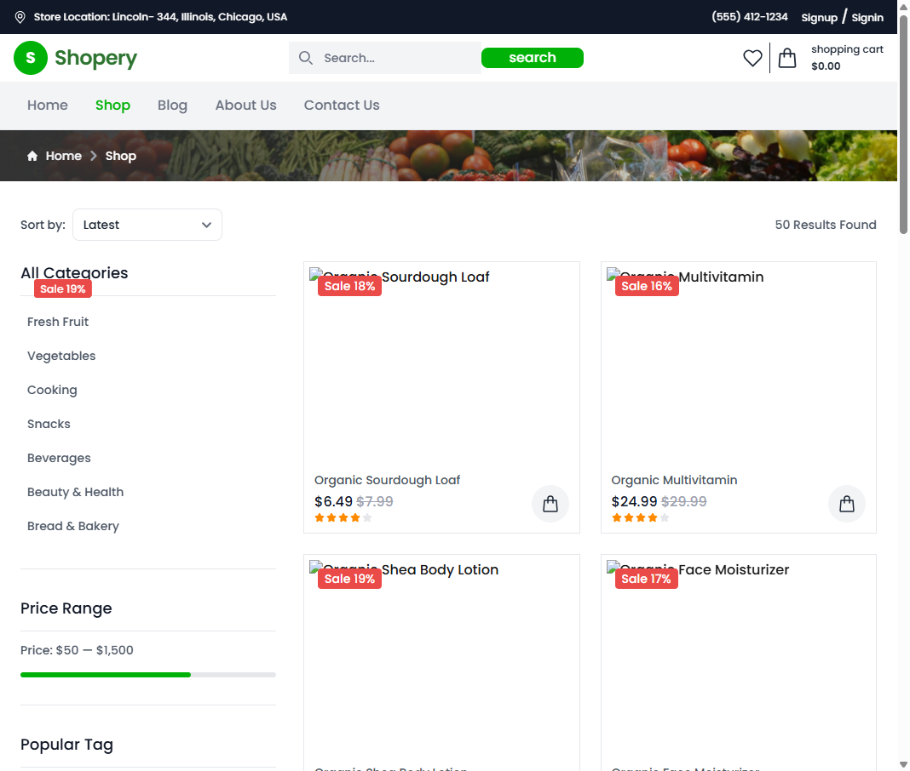
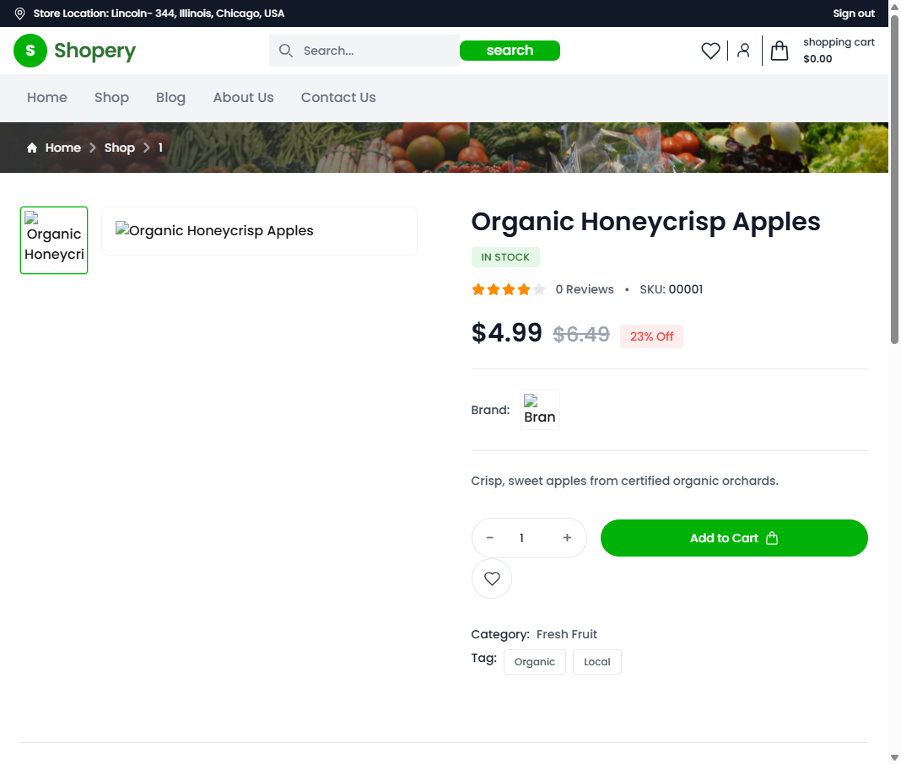
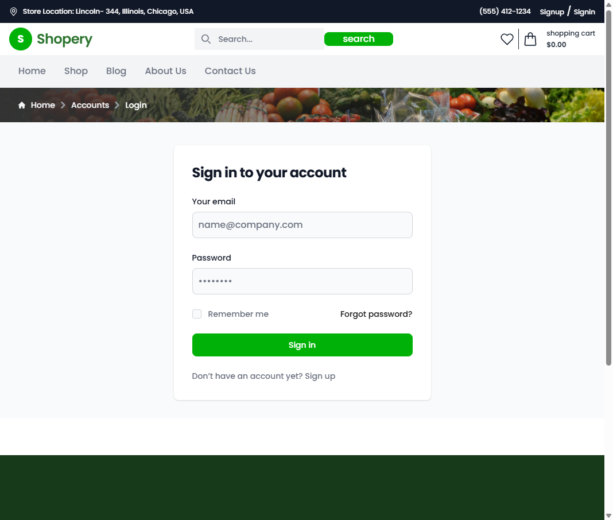
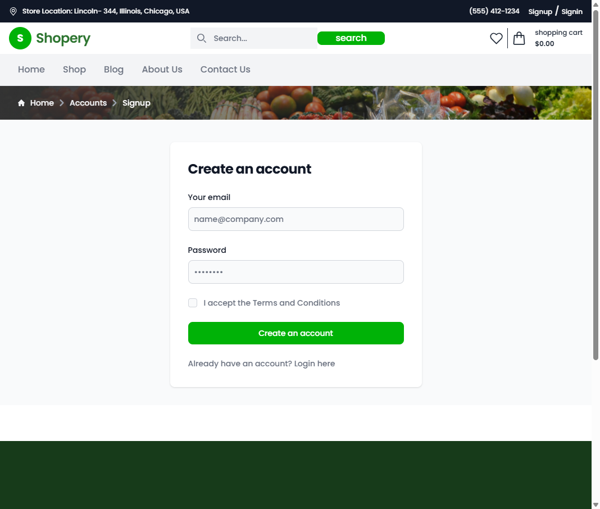
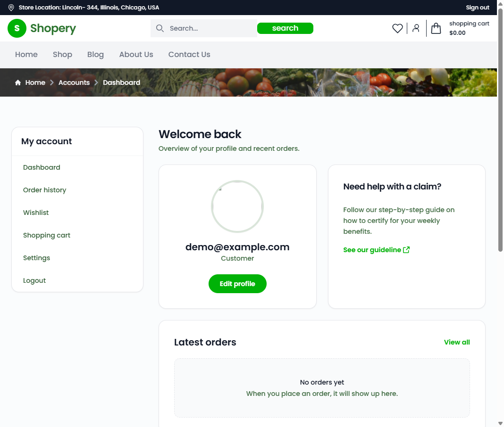

# Shopery

Shopery-inspired organic grocery eCommerce built with Django — catalog, cart, checkout, and customer accounts.

## Stack

- **Backend:** Django 5, django-allauth
- **UI:** Tailwind CSS (build via `npx tailwindcss`)
- **Dev DB:** SQLite (`db.sqlite3`)
- **Docker:** Python web service + PostgreSQL 16 (port **8001** on host)

## Quick start

### Docker (recommended)

```bash
docker compose up -d --build
```

Open [http://127.0.0.1:8001/](http://127.0.0.1:8001/)

First run (inside the web container):

```bash
docker compose exec web python manage.py migrate
docker compose exec web python manage.py seed_products
```

### Local venv

```bash
python -m venv .venv
.venv\Scripts\activate          # Windows
pip install -r requirements.txt
python manage.py migrate
python manage.py seed_products
python manage.py runserver 127.0.0.1:8000
```

Tailwind watch (separate terminal):

```bash
npx tailwindcss -i ./static/css/src/input.css -o ./static/css/src/output.css --watch
```

## Seed catalog

```bash
python manage.py seed_products              # upsert ~50 organic products
python manage.py seed_products --clear      # wipe shop data, then seed
python manage.py seed_products --dry-run    # preview only
```

## Key URLs

| Page | URL |
|------|-----|
| Home | `/` |
| Shop | `/shop/` |
| Product detail | `/shop/<id>/` |
| Cart | `/cart/` |
| Checkout | `/checkout/` |
| Wishlist | `/wishlist/` |
| Login | `/accounts/login/` |
| Register | `/accounts/signup/` |
| Dashboard | `/accounts/dashboard/` |
| Admin | `/admin/` |

## Dev demo user

For dashboard screenshots and local testing (Docker DB only — create with `manage.py shell` or signup):

| Email | Password |
|-------|----------|
| `demo@example.com` | `demo1234` |

## Screenshots

Captured against Docker at `http://127.0.0.1:8001/`.

| Page | Preview |
|------|---------|
| Shop |  |
| Product detail |  |
| Login |  |
| Register |  |
| Dashboard |  |

Files: `docs/screenshots/{shop,product-detail,login,register,dashboard}.png`